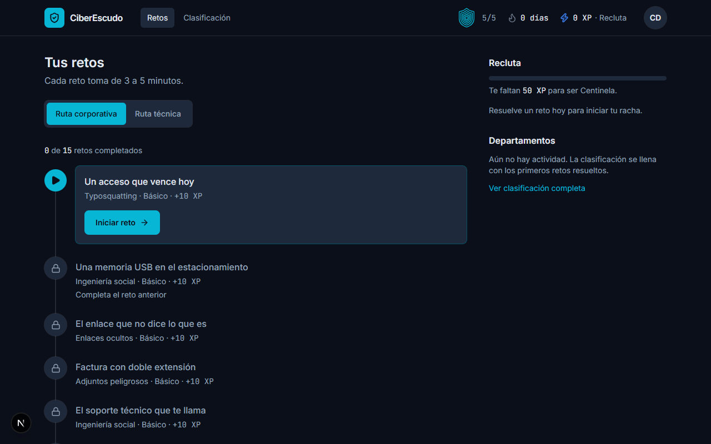
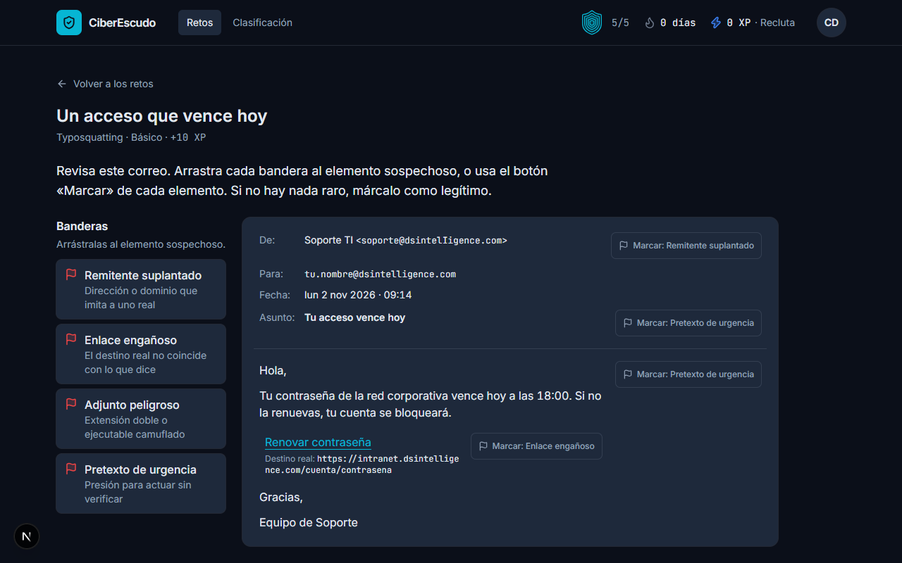
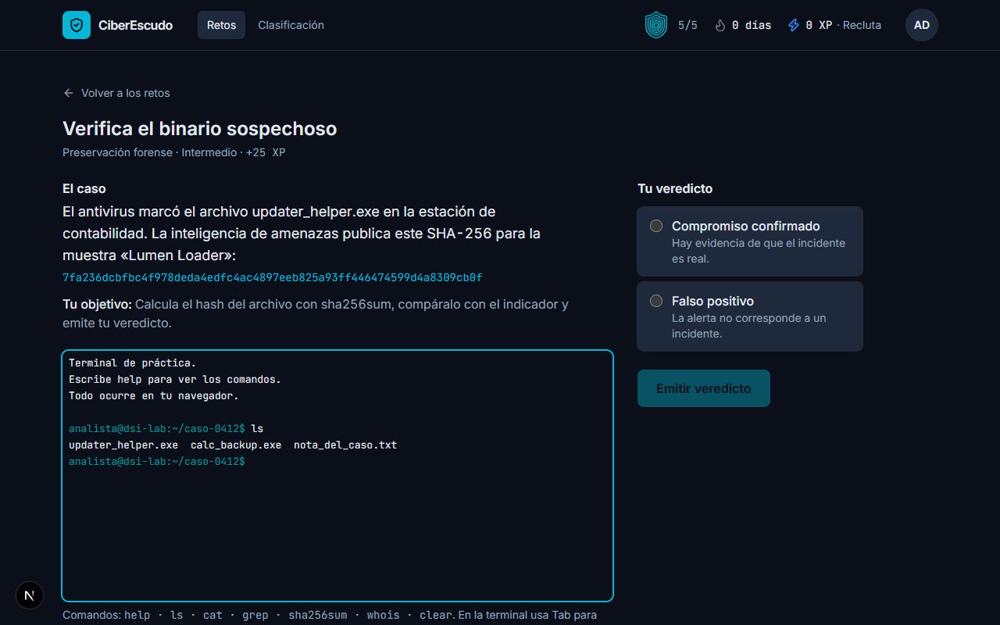
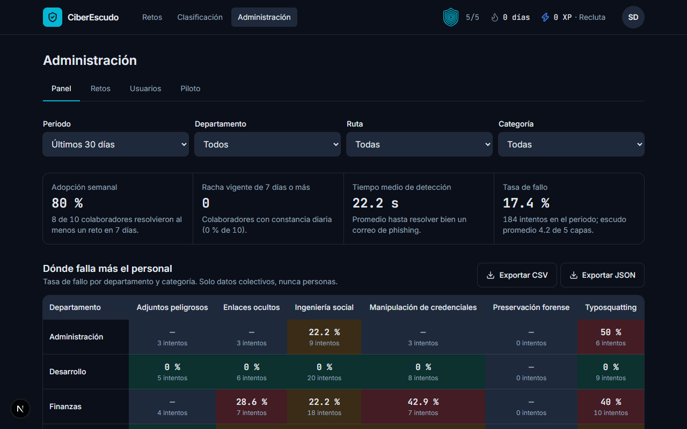
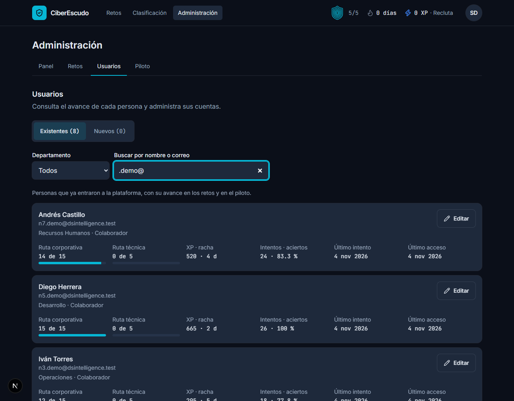
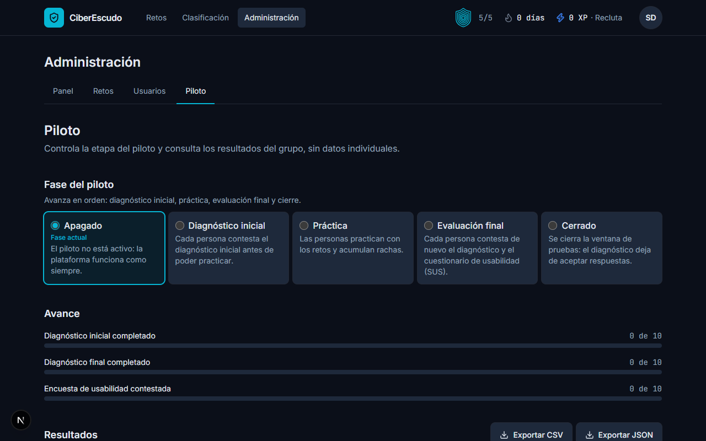
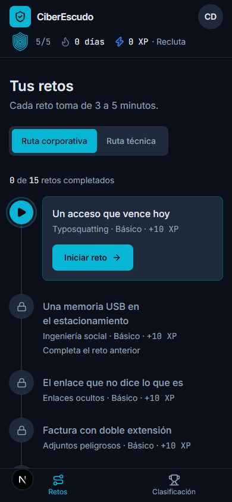

<div align="center">


**Aprende a detectar el phishing jugando. Retos de 3 a 5 minutos al día.**


</div>

Plataforma web gamificada de **microaprendizaje y simulación en ciberseguridad** para DS Intelligence,
desarrollada como proyecto de Residencias Profesionales (Instituto Tecnológico de Tlalnepantla, Campus Oriente).
Todo el contenido (correos, registros, hashes y dominios) es **sintético**: nunca se carga información real de la empresa.

## Contenido

[Vista previa](#vista-previa) · [Qué hace](#qué-hace) · [Arquitectura](#arquitectura) · [Gamificación](#gamificación) ·
[Pruébalo en 3 minutos](#pruébalo-en-3-minutos) · [Inicio rápido](#inicio-rápido) · [Pruebas](#pruebas) ·
[Despliegue con Docker](#despliegue-con-docker) · [Seguridad](#seguridad) · [Administración](#administración) ·
[Piloto](#piloto) · [Estructura](#estructura-del-proyecto) · [Hoja de ruta](#hoja-de-ruta) · [Autoría](#autoría)

---

## Vista previa

> Capturas reales de la plataforma con datos sintéticos.

<table>
  <tr>
    <td width="50%"><br><sub><b>Centro de retos</b>: escudo, racha, XP y la ruta de aprendizaje.</sub></td>
    <td width="50%"><br><sub><b>Cazador de phishing</b>: arrastra banderas sobre lo sospechoso.</sub></td>
  </tr>
  <tr>
    <td width="50%"><br><sub><b>Terminal forense</b>: comandos reales sobre archivos ficticios.</sub></td>
    <td width="50%"><br><sub><b>Panel de SecOps</b>: indicadores y mapa de calor por departamento.</sub></td>
  </tr>
  <tr>
    <td width="50%"><br><sub><b>Usuarios</b>: avance de cada persona y gestión de cuentas.</sub></td>
    <td width="50%"><br><sub><b>Piloto</b>: fases, avance y resultados antes y después.</sub></td>
  </tr>
</table>

<p align="center"><br><sub>Responsivo desde 360 px.</sub></p>

---

## Qué hace

```
   COLABORADOR                 ANALISTA TÉCNICO              ADMINISTRADOR SECOPS
  +-------------+             +----------------+            +--------------------+
  | Ruta        |             | Ruta técnica   |            | Gestiona los retos |
  | corporativa |             | forense        |            | Ve métricas        |
  | 15 retos    |             | 5 retos        |            | Sigue el avance    |
  +------+------+             +-------+--------+            +---------+----------+
         |                            |                               |
         v                            v                               v
  [ Inspección de phishing ]  [ Terminal emulada ]            [ Mapa de calor ]
  [ Decisiones rápidas     ]  [ Cadena de custodia ]          [ Usuarios y piloto ]
```

| Módulo | Qué se practica |
| --- | --- |
| **Cazador de phishing** | Una bandeja de correo simulada: arrastra banderas sobre remitentes falsos, enlaces ocultos y adjuntos peligrosos. |
| **Decisiones rápidas** | Escenarios de 30 segundos: una memoria USB desconocida, una llamada de «soporte», una clave pegada en el chat. |
| **Terminal forense** | Consola en el navegador con `ls`, `cat`, `grep`, `sha256sum` y `whois` sobre archivos ficticios. **No ejecuta nada en el servidor.** |
| **Cadena de custodia** | Ordena la evidencia por volatilidad (RAM → red → procesos → disco), según RFC 3227. |

Son **20 retos** en dos rutas, más 8 correos de diagnóstico reservados para el piloto.

---

## Arquitectura

```
                      Internet / intranet
                              |
                       https :8443 / :443
                              |
   +--------------------------v---------------------------+
   |  NGINX    TLS 1.3 · HSTS · CSP · límite de peticiones |   red: edge
   +------------+-----------------------------+-----------+
                |                             |
         /      |                             |  /api
   +------------v-----------+      +----------v-------------+
   |  FRONTEND (Next.js)    |      |  BACKEND (Express)     |   redes
   |  interfaz + BFF de     |----->|  reglas, evaluación,   |   internas
   |  sesión (cookie httpOnly)     |  JWT, administración   |
   +------------------------+      +----------+-------------+
                                              |
                                   +----------v-------------+
                                   |  POSTGRESQL 16         |   red: data
                                   |  solo el backend llega |   (sin salida)
                                   +------------------------+
```

| Capa | Tecnología |
| --- | --- |
| Interfaz | Next.js 16 (React 19) + Tailwind CSS, xterm.js, dnd-kit |
| API | Node.js + Express + TypeScript, Prisma, Zod, JWT |
| Datos | PostgreSQL 16 |
| Borde | Nginx (TLS 1.3, cabeceras de seguridad, límite de peticiones) |

---

## Gamificación

```
   ESCUDO PERIMETRAL                RACHA                     XP
   [#####] 100 %  correcto          dia 1  . . .              básico        10
   [####.]  80 %  -20 por fallo     dia 7  * * *  x1.2        intermedio    25
   [###..]  60 %                    dia 30 * * *  x1.5        avanzado      50
   [##...]  40 %
   [#....]  20 %                    (días calendario de la    solo la primera
   [.....]   0 %  -> pausa 2 min     Ciudad de México)         vez que resuelves
                    + píldora de repaso                         un reto
```

- Cada fallo resta **20 %** del escudo; en 0 % hay una pausa de 2 minutos con una explicación para repasar.
- La **racha** sube un día si practicas en días calendario consecutivos y se reinicia si te saltas uno.
- El **XP** se multiplica con la racha (×1.2 desde 7 días, ×1.5 desde 30).
- Las reglas son funciones puras y probadas: [`backend/src/modules/gamification/rules.ts`](backend/src/modules/gamification/rules.ts).

---

## Pruébalo en 3 minutos

Con Docker instalado, desde la carpeta `infra/`:

```bash
cp .env.example .env     # completa SERVER_NAME, POSTGRES_PASSWORD, JWT_ACCESS_SECRET y JWT_REFRESH_SECRET
docker compose up -d --build
./scripts/create-admin.sh
```

```
   [1] copia el .env  ──►  [2] levanta el stack  ──►  [3] crea tu administrador
                                                              │
                                   https://SERVER_NAME  ◄─────┘   y entra
```

Para ver la plataforma con usuarios de demostración, pon `SEED_DEMO_USERS=true` y una `SEED_PASSWORD` en `infra/.env`
**solo en pruebas**. El navegador avisará del certificado autofirmado; los detalles están en [Despliegue con Docker](#despliegue-con-docker).

---

## Inicio rápido

Para desarrollar sin Docker. Requisitos: **Node.js 22 o superior** y **PostgreSQL 16**.

```bash
# Backend (http://localhost:4000)
cd backend
cp .env.example .env            # revisa DATABASE_URL y los secretos
npm install
npx prisma migrate deploy
npm run db:seed                 # catálogos, 20 retos y usuarios de prueba
npm run dev

# Frontend (http://localhost:3000), en otra terminal
cd frontend
echo "BACKEND_URL=http://localhost:4000" > .env.local
npm install
npm run dev
```

Los usuarios de prueba (`colaborador@`, `analista@` y `secops@dsintelligence.test`) usan la contraseña
que definas en `SEED_PASSWORD` dentro de `backend/.env`.

---

## Pruebas

```
  backend   216 pruebas   reglas, evaluadores, autenticación, administración, piloto
  frontend   22 pruebas   motor de la terminal y lógica del simulador de phishing
  e2e         4 flujos    login → reto → XP · admin → reto → panel · piloto · usuarios
```

```bash
cd backend  && npm test         # usa la base real y corre archivo por archivo
cd frontend && npm test         # pruebas unitarias
cd frontend && npm run e2e      # flujo completo con Microsoft Edge; limpia lo que crea
```

> Las pruebas E2E y las del backend con base de datos reinician progreso y borran intentos del diagnóstico:
> úsalas solo con la base de **desarrollo**, nunca con un piloto en curso.

---

## Despliegue con Docker

Requisitos: Docker Engine con Compose v2, en un servidor Linux (Debian/Ubuntu).

```bash
cd infra
cp .env.example .env
# Edita .env: SERVER_NAME, POSTGRES_PASSWORD, JWT_ACCESS_SECRET y JWT_REFRESH_SECRET.
#   openssl rand -hex 24      → contraseña de la base (solo letras y números)
#   openssl rand -base64 48   → cada secreto JWT (deben ser distintos)
docker compose up -d --build
docker compose ps             # todos deben quedar en "healthy"
```

El primer arranque aplica las migraciones y carga los catálogos y los 20 retos. No crea usuarios.
Crea el primer administrador (la contraseña se pide sin eco, mínimo 12 caracteres):

```bash
./scripts/create-admin.sh
```

Después entra al **portal de administración**: `https://SERVER_NAME/admin/login`. Las demás personas entran por `https://SERVER_NAME/login`.

### Certificados

La primera vez se genera un certificado **autofirmado** (los navegadores mostrarán una advertencia).
Para producción coloca el de la CA de la empresa en `infra/certs/` como `fullchain.pem` y `privkey.pem`
antes de `docker compose up`: si existen, no se genera ninguno. Para renovarlo, reemplaza los archivos y
ejecuta `docker compose restart nginx`.

### Variables (`infra/.env`)

| Variable | Qué hace |
| --- | --- |
| `SERVER_NAME` | Nombre con el que se accede; debe coincidir con el certificado. |
| `HTTP_PORT`, `HTTPS_PORT` | Puertos publicados (80 y 443 por defecto). |
| `POSTGRES_DB`, `POSTGRES_USER`, `POSTGRES_PASSWORD` | Base de datos. La contraseña es obligatoria. |
| `JWT_ACCESS_SECRET`, `JWT_REFRESH_SECRET` | Firma de sesiones. Obligatorias y distintas; la API no arranca con valores de ejemplo. |
| `SEED_DEMO_USERS`, `SEED_PASSWORD` | Solo para pruebas: crea colaborador, analista y SecOps de demostración. |

### Operación

Verificado con Docker Desktop 4.97 (Engine 29, Compose 5): las imágenes compilan, los servicios quedan `healthy`,
los datos sobreviven a `docker compose down` y los respaldos se restauran. Las imágenes pesan ~760 MB (API), ~400 MB (web) y ~74 MB (Nginx).

```bash
docker compose logs -f backend                        # registros
docker compose pull && docker compose up -d --build   # actualizar
./scripts/backup.sh                                   # respaldo en infra/backups/ (comprimido)
./scripts/restore.sh backups/ARCHIVO.sql.gz           # restaurar (pide confirmación)
```

Programa `backup.sh` con cron (por ejemplo, a diario) y copia `infra/backups/` fuera del servidor.
Las migraciones se aplican solas al arrancar el backend. Haz un respaldo antes de actualizar.

### Problemas frecuentes

- *La redirección de HTTP a HTTPS pierde el puerto*: solo ocurre si cambias `HTTPS_PORT`; con 80/443 es correcta. Con otros puertos entra directo a `https://SERVER_NAME:PUERTO`.
- *Los scripts de `infra/scripts` son de shell*: en Windows ejecútalos desde Git Bash o WSL.
- *«define POSTGRES_PASSWORD en infra/.env»*: falta completar un valor obligatorio.
- *No inicia sesión por HTTP*: la cookie de sesión es `Secure`; usa siempre `https://`.
- *El navegador bloquea el sitio por el certificado*: es el autofirmado. En desarrollo usa un certificado local de confianza
  (por ejemplo con `mkcert`) o el de la CA de la empresa en producción.
- *La base no conecta tras cambiar la contraseña*: Postgres solo lee `POSTGRES_PASSWORD` al crear el volumen.
  Cámbiala con `ALTER USER` o recrea el volumen (`docker compose down -v` borra los datos).

---

## Seguridad

```
  INTERNET ──► [ NGINX ] ──► [ FRONTEND ] ──► [ BACKEND ] ──► [ BASE DE DATOS ]
                 ▲  solo este                                     ▲  solo lo ve
                 │  puerto está expuesto                          │  el backend
```

- **Solo Nginx está expuesto.** La base de datos, el backend y el frontend viven en redes internas
  sin salida a internet; la base solo la alcanza el backend.
- **TLS 1.3**, HSTS, `Content-Security-Policy`, `X-Frame-Options: DENY`, `nosniff`, `Referrer-Policy` y `Permissions-Policy`.
  La CSP permite estilos y scripts en línea por Next.js y xterm.js; endurecerla con *nonces* es una mejora futura.
- **Límite de peticiones por IP**, con el inicio de sesión a 5 por minuto.
- **Backend, frontend y Nginx sin root**, con el sistema de archivos de solo lectura. Todos los servicios
  llevan `no-new-privileges` y sin capacidades de Linux (Postgres conserva las 5 que necesita para su arranque).
- **Sesiones**: el token de renovación va en una cookie `httpOnly` + `Secure` + `SameSite=Lax`, de un solo uso y con
  detección de reutilización; el de acceso solo vive en memoria y dura 15 minutos. Contraseñas con **argon2id**.
- **La terminal es una simulación**: un analizador determinista en el navegador sobre archivos virtuales. Un comando
  desconocido responde `command not found` y no genera ninguna petición al servidor.
- **Sin documentación de la API expuesta** (`/docs` devuelve 404) y sin usuarios de demostración por defecto.
- La API se niega a arrancar si los secretos JWT son los de ejemplo o son iguales entre sí.
- **Las soluciones nunca salen del servidor**: la API envía el reto sin su respuesta correcta.

---

## Administración

Hay **dos entradas separadas** para que nadie se confunda:

```
   PERSONAS USUARIAS                         ADMINISTRADORES (SecOps)
   /login                                    /admin/login
   retos · escudo · racha · XP               panel · retos · usuarios · piloto
   (sin nada de administración)              (sin escudo, racha ni XP)
```

Una cuenta de administración no entra por `/login` ni una cuenta de usuario por `/admin/login`: cada una solo
abre su portal. El portal de administración tiene estas pestañas:

| Pestaña | Qué permite |
| --- | --- |
| **Panel** | Adopción, adherencia a rachas, tiempo medio de detección y un **mapa de calor** departamento × categoría. Las celdas con menos de 5 intentos no muestran porcentaje. Exporta a CSV o JSON. |
| **Retos** | Alta, edición y baja de retos con formularios por tipo (correo de phishing, decisión rápida, cadena de custodia, terminal). |
| **Usuarios** | **Invita** a una persona o a varias a la vez (se crean sus cuentas con una contraseña inicial que se muestra una sola vez). Dos listas: **Invitados** (aún sin primer acceso) y **Existentes**, con el avance de cada persona. Permite editar nombre, departamento y rol, desactivar cuentas y restablecer contraseñas. |
| **Piloto** | Controla la fase del piloto y muestra sus resultados. |

---

## Piloto

El piloto mide cuánto mejora la detección de phishing con la práctica. Se maneja desde **Administración → Piloto**.

```
   APAGADO ─► DIAGNÓSTICO ─► PRÁCTICA ─► EVALUACIÓN ─► CERRADO
              INICIAL                    FINAL + SUS
              (8 correos)    (retos      (los mismos 8
              práctica       diarios)    + cuestionario)
              bloqueada
```

**1. Alta de participantes.** Prepara un CSV con las columnas `correo, nombre, departamento, rol` (rol `COLABORADOR` o `ANALISTA`; vacío = `COLABORADOR`):

```bash
# Desarrollo (desde backend/)
npm run pilot:users -- participantes.csv > credenciales.csv
# Docker (desde infra/)
./scripts/import-participants.sh participantes.csv credenciales.csv
```

Si cualquier línea tiene un error no se crea ninguna cuenta. Las contraseñas iniciales salen solo en la hoja de credenciales: entrégalas por un canal seguro y bórrala. `--reset` restablece la contraseña de cuentas que ya existen. Cada persona puede cambiarla en el menú de su cuenta.

**2. Fases.** Avanza en orden: *Diagnóstico inicial* (la práctica queda bloqueada hasta terminarlo) → *Práctica* → *Evaluación final* (diagnóstico de nuevo + cuestionario SUS) → *Cerrado*. El diagnóstico son 8 correos distintos de los de práctica (6 maliciosos y 2 legítimos), sin retroalimentación ni efecto en XP, escudo o racha.

**3. Resultados.** La pestaña muestra la variación de detección, falsos positivos y tiempo medio de detección (solo quienes hicieron ambos diagnósticos), la adherencia (4 o más días seguidos practicando) y el SUS (meta: promedio mayor a 80). Se exportan en CSV o JSON, siempre agregados, sin datos individuales.

**4. Prueba de carga.** Con la API compilada corriendo (`npm run build && npm start` en `backend/`): `npm run loadtest -- --connections 30 --duration 15`. Crea cuentas temporales, mide latencia contra la meta de 300 ms (p97.5) y las borra. Con 30 conexiones simultáneas: 0 errores y p97.5 de 242 ms.

---

## Estructura del proyecto

```
ciberescudo/
├── backend/               API (Express + TypeScript)
│   ├── prisma/            esquema, migraciones y seed de los 20 retos
│   ├── src/modules/       auth · challenges · attempts · gamification
│   │                      metrics · pilot · admin
│   ├── scripts/           alta de administradores y participantes, carga
│   └── tests/             216 pruebas
├── frontend/              interfaz (Next.js)
│   ├── app/               pantallas: retos, clasificación, administración…
│   ├── components/        simulador de phishing, terminal, panel de control
│   ├── lib/               cliente de la API, motor de la terminal
│   └── e2e/               pruebas de extremo a extremo (Playwright)
├── infra/                 docker-compose, Nginx, certificados y respaldos
├── DESIGN.md              sistema de diseño (colores, tipografía, componentes)
└── PRODUCT.md             a quién sirve el producto y su tono
```

---

## Hoja de ruta

```
   HECHO                                   PENDIENTE
   [x] 2 rutas y 20 retos                  [ ] Piloto con personal de la empresa
   [x] Escudo, rachas y XP                 [ ] Integración con Active Directory / LDAP
   [x] Panel, usuarios y mapa de calor     [ ] Generación asistida de escenarios con IA local
   [x] Piloto, SUS y reportes              [ ] CSP con nonces (hoy usa 'unsafe-inline')
   [x] Docker, Nginx y TLS 1.3             [ ] Certificado de la CA de la empresa
```

---

## Autoría

Proyecto de Residencias Profesionales de **Alejandro David Hernández Hernández**
(Ingeniería en Tecnologías de la Información y Comunicaciones, especialidad en Ciberseguridad y Cómputo Forense)
· Tecnológico Nacional de México, Instituto Tecnológico de Tlalnepantla, Campus Oriente
· Empresa receptora: DS Intelligence.

<div align="center">

```
      .-""""-.
     / .--.   \       "El eslabón más débil de la seguridad
    | |    |   |       suele ser una persona con prisa.
    | |    |   |       Entrénala en 5 minutos al día."
     \ '--'   /
      '-.__.-'
```

</div>
